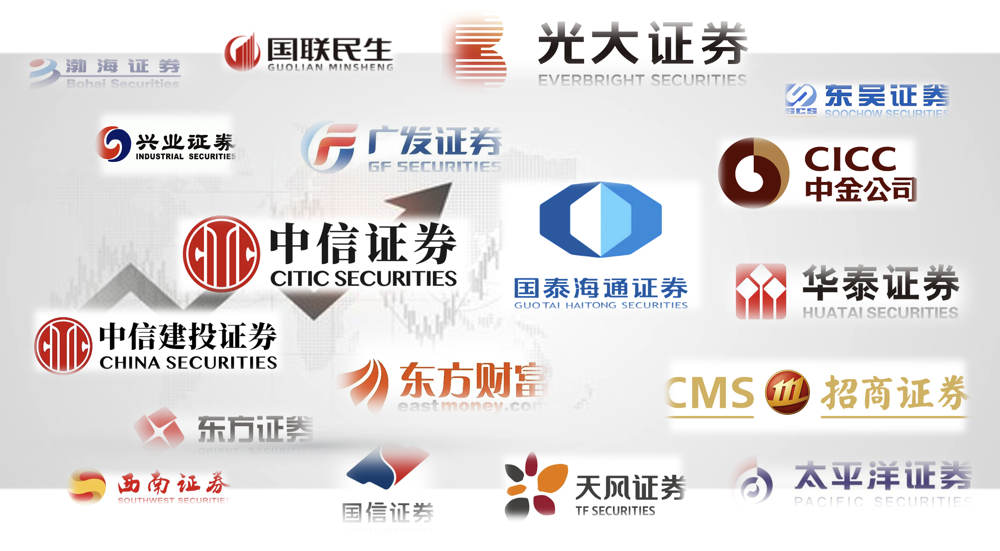
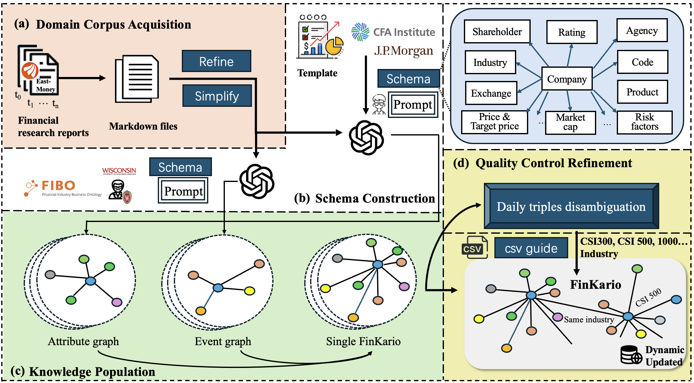
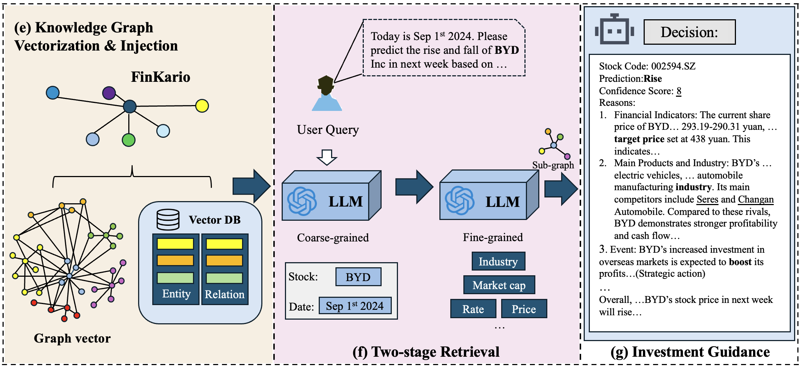
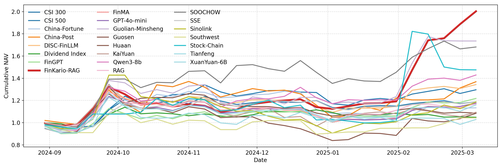

# FinKario
<p align="center">
    
<p>

## Disclaimer  
The content and software in this repository are provided **for academic research and educational purposes only**.  
All outputs are **not** financial, legal, or investment advice.  
Users must exercise their own judgment and, where necessary, seek professional advice.  
By using any part of this project you agree to hold the authors and their affiliated organizations **harmless from any and all claims or damages** that may arise.


## 1 · FinKario Introduction  
FinKario is an automated pipeline that converts raw Chinese equity‐research reports into a dynamic financial knowledge-graph and a graph-based retrieval-augmented generation (RAG) system.

* **Scale** – > **305 360 entities**, **9 625 relational triples**, **19 relation types**  
* **Fully automated** – schema extraction → attribute graph → event graph → refinement  
* **Up-to-date** 


## 2 · FinKario Datasets Pipeline  

<p align="center">
  
</p>

The pipeline (figure above) automatically parses markdown-formatted research reports, extracts attributes & events, refines entity, and finally fuses everything into **FinKario**.


## 3 · FinKario-RAG  

<p align="center">
  
</p>

FinKario-RAG employs a **two-stage, graph-based retrieval strategy** that first selects a coarse sub-graph and then performs fine-grained vector search, guaranteeing efficient and precise access to constantly evolving financial knowledge.


## 4 · Quick Start  

### Preparation  

1. **Download dataset** – [FinKario Dataset](https://drive.google.com/drive/folders/1G0BgRxC1dHXO4tqvj8ta-NSaPGrsJAv0)  
   * copy `stock_data.csv` **and** the entire `output` folder to `./data/`  
2. Install dependencies  

   ```bash
   pip install -r requirements.txt
   ```
3. Run the whole pipeline
   ```bash
   bash FinKario.sh
   ```

## 5 · Performance

<p align="center">  </p>
The red line shows FinKario-RAG, consistently outperforming mainstream broker benchmarks and other LLM baselines in cumulative NAV back-testing.


## 6 · Acknowledgements  

FinKario benefits greatly from prior open-source work.  
We would like to thank:

* **[LightRAG](https://github.com/HKUDS/LightRAG)** – the lightweight, graph-aware RAG framework that underpins our two-stage retrieval storage structure.  
* **[MinerU](https://github.com/opendatalab/MinerU)** – a one-stop, open-source high-quality data-extraction toolkit that converts PDFs into structured Markdown and JSON.  
  MinerU was used to **transform raw equity-research report PDFs into clean Markdown files**, which subsequently feed the FinKario attribute- and event-extraction modules.

We sincerely appreciate the authors and the open-source community for making these resources available.

   
## 7 · Citation

If you use FinKario in your work, please cite our paper.
